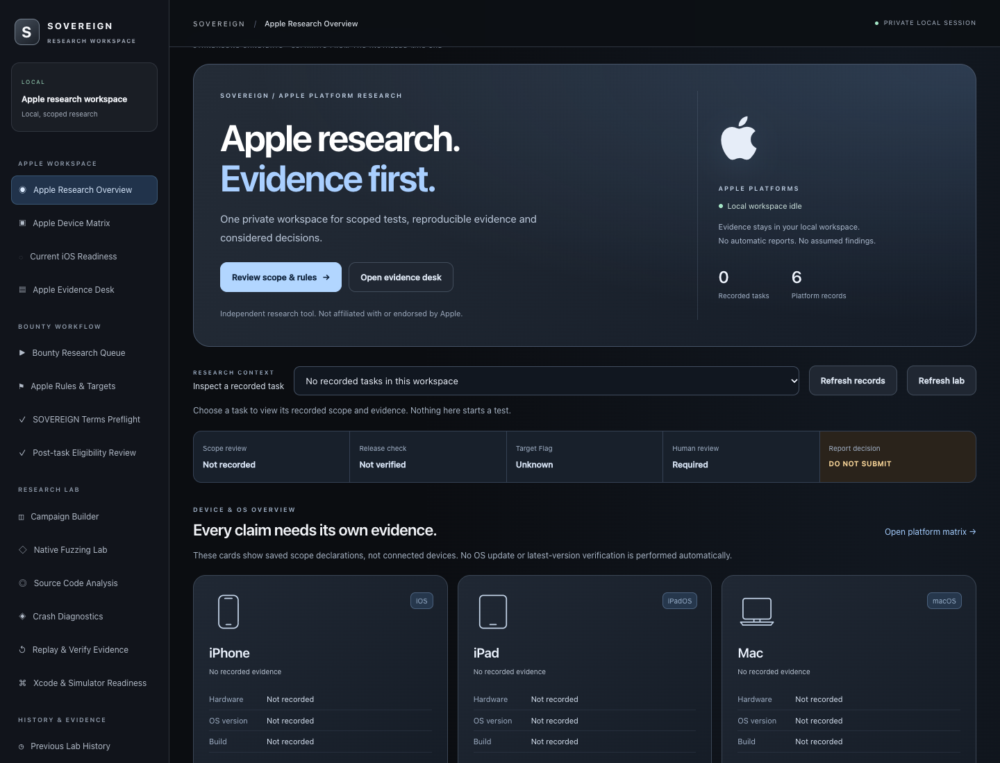
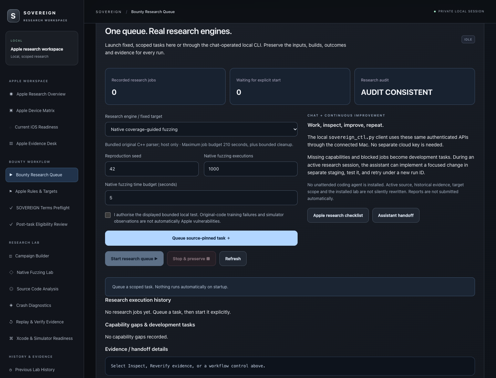
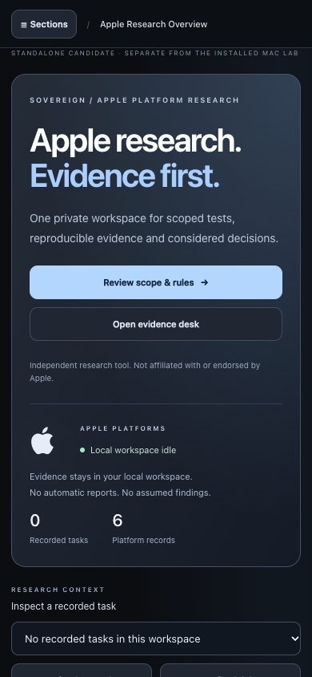

# SOVEREIGN

### Apple-platform security research workspace

**Evidence first · Scoped testing · Independent verification**

**PUBLIC PORTFOLIO ONLY — PRIVATE SOFTWARE — NO SOURCE CODE OR DOWNLOADS**

---

*Current accepted interface · fresh local capture: **29 October 2026, 17:07 GMT** · SOVEREIGN **v2.8.7rc1** · isolated empty research workspace.*

## About SOVEREIGN

**SOVEREIGN** is an independently developed security research workspace for structured investigation of Apple-platform behaviours, local parser reliability, and reproducible security testing.

The private lab brings together bounded research jobs, platform-readiness checks, evidence collection and independent review. Its focus is to make a clear distinction between **a test observation**, **a candidate vulnerability**, and **a verified security impact**.

> **Important:** This repository is a visual portfolio. It does not contain SOVEREIGN's application, source code, fuzzing harnesses, tests, build outputs, binaries, datasets, technical exploit details or credentials. It cannot be installed or run from this repository.

## What the research lab covers

| Area | Public overview |
|:--|:--|
| **Apple-platform research** | Structured workflows for macOS and planned iOS/iPadOS investigations, with device- and OS-specific verification gates |
| **Native research engines** | Privately maintained parser test harnesses, controlled corpus execution, process monitoring and reproducibility checks |
| **Framework comparisons** | Synthetic-input comparisons covering Apple Foundation, WebKit, ImageIO and Quick Look research pathways |
| **Evidence integrity** | Source and binary fingerprints, paired execution receipts, repeated runs and independent evidence verification |
| **Responsible reporting** | Scope checks and human review before any vulnerability claim or disclosure |

Actual supported platforms and research readiness are evaluated separately. A simulator run is not proof of a vulnerability on a physical Apple device.

## Selected independently verified milestones

<small>Public snapshot: 29 October 2026. These milestones describe private local research; they are not findings of Apple vulnerabilities.</small>

| Research milestone | Verified outcome |
|:--|:--|
| Accepted local showcase source: **v2.8.7rc1** | Validated SOVEREIGN user interface and scoped evidence workflow |
| macOS ImageIO generated-input campaigns | 576 distinct synthetic inputs; **1,152** native executions; no unexpected process failure in those bounded runs |
| Quick Look / ImageIO type-hint comparison | Two independently verified 96-case runs; observed differences consistent with declared-type handling |
| Same-path preview and type-hint changes | Two independent runs; fresh-path and updated-path controls matched |
| Concurrent thumbnail and cancellation controls | 96 total synthetic preview requests; correct image association and expected cancellation results |
| iOS Simulator readiness | First-boot migration problem documented; native iOS work is not represented as ready or bounty-validated |

**Research versions:** the main interface shown is the current accepted **v2.8.7rc1**; later **v3.0.x** milestones are experimental research modules, not a newer released graphical application.

**Current finding classification:** research observations and negative controls. **No confirmed zero-click exploit, zero-day vulnerability or Apple Security Bounty claim** is presented here.

## Visual tour

### Research operations and scoped workflow

*Fresh capture from the current accepted SOVEREIGN interface on 29 October 2026; the screenshot uses an isolated empty workspace. No functional backend is distributed.*

### Compact research overview

*Fresh mobile-width rendering of the current accepted local interface, captured 29 October 2026; it does not represent a released iPhone application.*

## Research lifecycle

The private lab follows an evidence-led review process:

\`\`\`mermaid
flowchart LR
  A["Scope and safety controls"] --> B["Synthetic or authorised test"]
  B --> C["Local execution and receipts"]
  C --> D["Independent evidence verification"]
  D --> E{"Human security-impact review"}
  E -->|Insufficient impact| F["Preserve research notes"]
  E -->|Actionable and in scope| G["Responsible disclosure review"]
\`\`\`

Nothing in the public portfolio can trigger these steps or access the private lab.

## Access and rights

SOVEREIGN's software is **not publicly distributed**. No download, runnable package, remote research endpoint, account sign-up or source checkout is available in this repository.

This public repository contains only screenshots and descriptive material. All rights are reserved; no software licence is granted. Please read [Rights and use](RIGHTS_AND_USE.md). GitHub may still let visitors view, save or fork these public presentation materials; keeping the executable software private is the security boundary.

## Independent research

SOVEREIGN is a personal, independent project, **not affiliated with, approved by or endorsed by Apple Inc.** Apple product names and any platform imagery appearing within interface screenshots are used solely to identify the research context. There is no claim that Apple participates in or approves this project.

Security issues involving Apple products should follow the applicable Apple reporting and eligibility guidelines. The underlying research evidence is retained privately and is not published here.

**Further reading:** [Project overview](PROJECT_OVERVIEW.md) · [Responsible disclosure](RESEARCH_AND_DISCLOSURE.md) · [Rights and use](RIGHTS_AND_USE.md)

---

**SOVEREIGN — Evidence first.**

*Visual research portfolio. Proprietary software remains private.*

